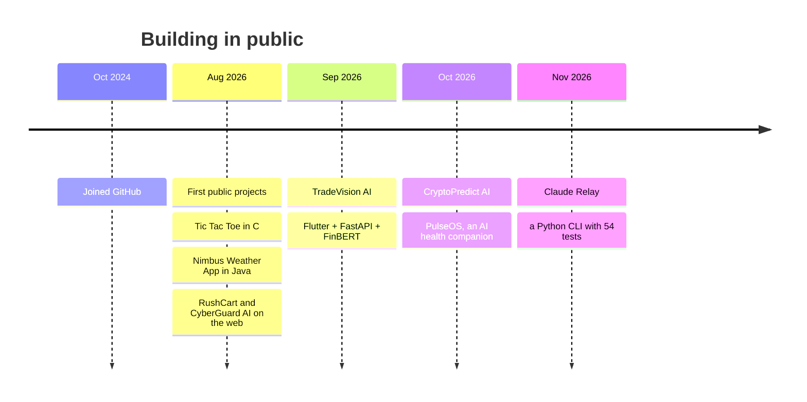

 

## 👨‍💻 About me

## 🚀 Featured projects

<table>
<tr>
<td width="50%"></td>
<td width="50%"></td>
</tr>
<tr>
<td width="50%"></td>
<td width="50%"></td>
</tr>
</table>

<b>📂 More projects</b>

 

| Project | What it is | Built with |
|---|---|---|
| [CyberGuard AI](https://github.com/CodeWidKrish/CyberGuardAI) | AI-powered cybersecurity awareness and threat analysis web app | HTML · CSS · JavaScript |
| [College Event Management](https://github.com/CodeWidKrish/CollegeEventManagement) | Manage events, registrations and venues for a college | Python |
| [Nimbus Weather App](https://github.com/CodeWidKrish/NimbusWeatherApp) | Weather information through a simple, friendly interface | Java |
| [RushCart](https://github.com/CodeWidKrish/RushCart) | Responsive e-commerce website with product listings and categories | HTML · CSS |
| [Tic Tac Toe](https://github.com/CodeWidKrish/TicTacToe) | The classic game in the terminal | C |
| [Heart](https://github.com/CodeWidKrish/Heart) | My first Python program: it draws a heart ❤️ | Python |

## 🛠️ Tech stack

**Languages & frameworks**  

**AI / ML & 3D**  

**Databases & cloud**  

**Tools**  

## 🏆 Achievements

<table>
<tr>
<td width="33%" align="center" valign="top">
<h3>🥇</h3>
<b>5th place, inter-college hackathon</b> 
Eduseart hackathon, recognised for fast architecture and real-time execution
</td>
<td width="33%" align="center" valign="top">
<h3>🛡️</h3>
<b><a href="https://github.com/CodeWidKrish/CyberGuardAI">CyberGuard AI</a></b> 
Threat-analysis platform that reached a wide developer audience on LinkedIn
</td>
<td width="34%" align="center" valign="top">
<h3>📈</h3>
<b><a href="https://github.com/CodeWidKrish/TradeVision-AI">TradeVision AI</a></b> 
Lead architect of a capstone stock-intelligence app with a Flutter UI and FastAPI backend
</td>
</tr>
</table>

## 🗺️ My journey

## 📊 GitHub stats

## 🐍 Contribution snake

<picture>
  <source media="(prefers-color-scheme: dark)" srcset="https://raw.githubusercontent.com/CodeWidKrish/CodeWidKrish/output/github-contribution-grid-snake-dark.svg">
  <source media="(prefers-color-scheme: light)" srcset="https://raw.githubusercontent.com/CodeWidKrish/CodeWidKrish/output/github-contribution-grid-snake.svg">
  
</picture>

## 🤝 Let's connect

I'm always happy to talk about **AI/ML, full-stack and mobile development**, or a project you're building.

  

