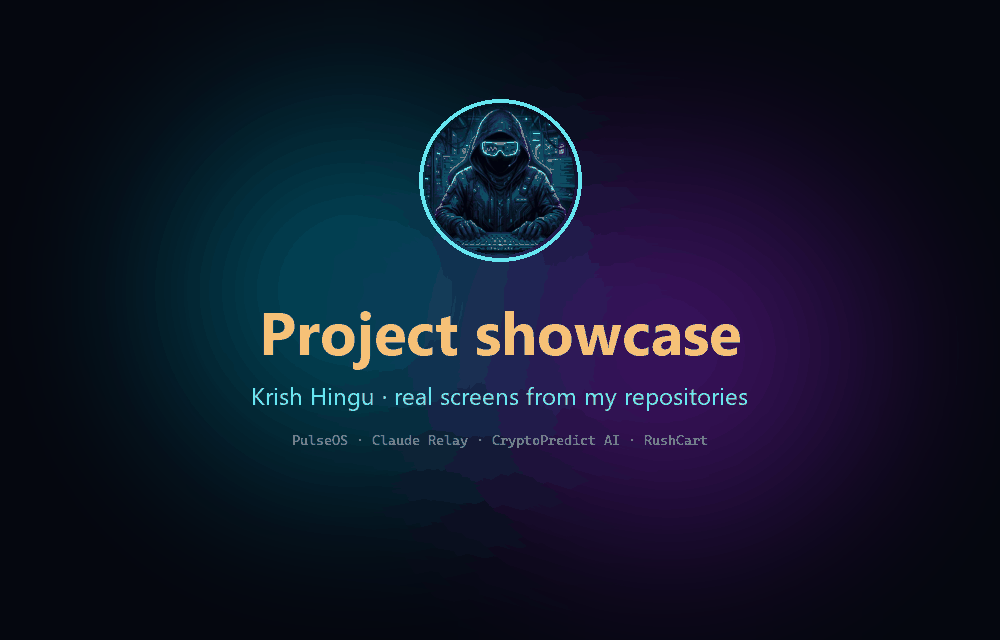
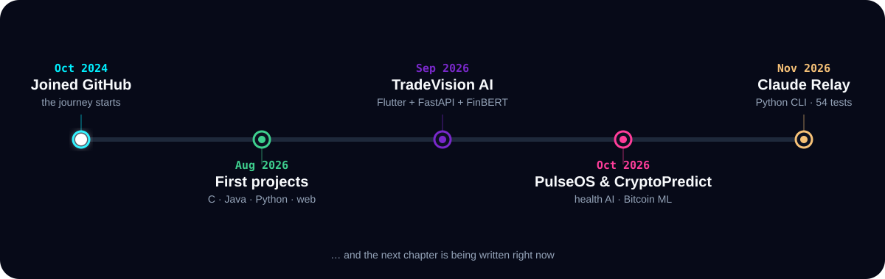
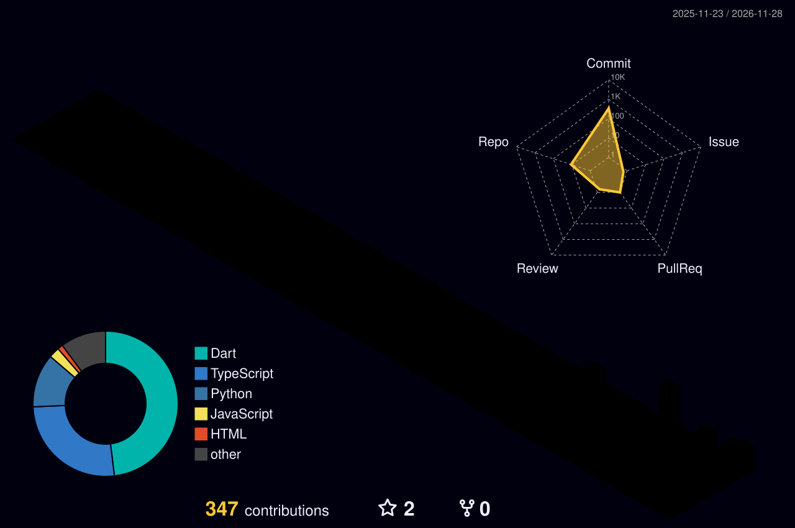
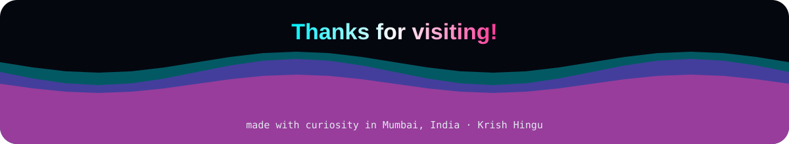

<b>
<a href="#about">About</a> ·
<a href="#showcase">Showcase</a> ·
<a href="#projects">Projects</a> ·
<a href="#tech">Tech</a> ·
<a href="#achievements">Achievements</a> ·
<a href="#journey">Journey</a> ·
<a href="#stats">Stats</a> ·
<a href="#playground">Playground</a> ·
<a href="#connect">Connect</a>
</b>

 

  

 

<table>
<tr>
<td width="50%"></td>
<td width="50%"></td>
</tr>
<tr>
<td width="50%"></td>
<td width="50%"></td>
</tr>
</table>

<b>📂 More projects</b>

 

| Project | What it is | Built with |
|---|---|---|
| [CyberGuard AI](https://github.com/CodeWidKrish/CyberGuardAI) | AI-powered cybersecurity awareness and threat analysis web app | HTML · CSS · JavaScript |
| [College Event Management](https://github.com/CodeWidKrish/CollegeEventManagement) | Manage events, registrations and venues for a college | Python |
| [Nimbus Weather App](https://github.com/CodeWidKrish/NimbusWeatherApp) | Weather information through a simple, friendly interface | Java |
| [RushCart](https://github.com/CodeWidKrish/RushCart) | Responsive e-commerce website with product listings and categories | HTML · CSS |
| [Tic Tac Toe](https://github.com/CodeWidKrish/TicTacToe) | The classic game in the terminal | C |
| [Heart](https://github.com/CodeWidKrish/Heart) | My first Python program: it draws a heart ❤️ | Python |

 

  

<table>
<tr>
<td width="33%"></td>
<td width="33%"></td>
<td width="33%"></td>
</tr>
</table>

 

  

 

<picture>
  <source media="(prefers-color-scheme: dark)" srcset="https://raw.githubusercontent.com/CodeWidKrish/CodeWidKrish/output/3d/profile-night-rainbow.svg">
  <source media="(prefers-color-scheme: light)" srcset="https://raw.githubusercontent.com/CodeWidKrish/CodeWidKrish/output/3d/profile-season-animate.svg">
  
</picture>

<picture>
  <source media="(prefers-color-scheme: dark)" srcset="https://raw.githubusercontent.com/CodeWidKrish/CodeWidKrish/output/github-contribution-grid-snake-dark.svg">
  <source media="(prefers-color-scheme: light)" srcset="https://raw.githubusercontent.com/CodeWidKrish/CodeWidKrish/output/github-contribution-grid-snake.svg">
  
</picture>

Both are rebuilt from my real contributions every 12 hours by a GitHub Action in this repository.

 

I'm always happy to talk about **AI/ML, full-stack and mobile development**, or a project you're building. 
Open to **internships, opportunities and collaborations**.

  

